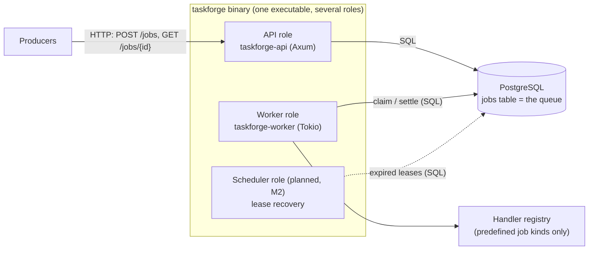
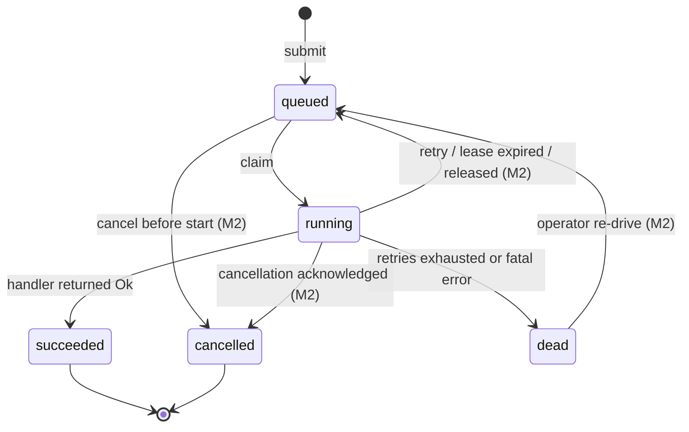
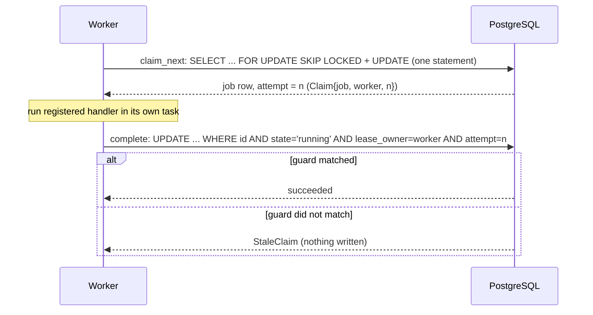

# TaskForge — Architecture

Status: **Milestone 1 implemented.** Sections describing later milestones are
marked *(planned)* and describe the intended design, not existing code.

## 1. Components

PostgreSQL is the only stateful component and the only coordination
mechanism. API and worker processes are stateless and can be started,
stopped and scaled independently. There is no broker and no leader election:
coordination is row locks and guarded `UPDATE`s (ADR 0001, ADR 0003).

### Crates

| Crate | Responsibility | Depends on |
|---|---|---|
| `taskforge-domain` | Pure rules, no I/O: `JobState` and its transition table, `Job`, `NewJob` validation, limits. | serde, uuid, chrono |
| `taskforge-storage` | Every SQL statement. Migrations, `JobStore` (insert, get, claim, complete, fail), `Claim` fencing token, error taxonomy. | domain, sqlx |
| `taskforge-api` | Axum router, request validation, error envelope, health endpoints. | domain, storage, axum |
| `taskforge-worker` | Handler trait and registry, built-in handlers, the claim-execute-settle loop. | domain, storage, tokio |
| `taskforge` (bin) | Configuration from environment, logging, signal handling, role selection. | all of the above |
| `taskforge-scheduler` *(planned, M2)* | Lease reaper; later, metrics sampling. | domain, storage |

The split follows the direction of knowledge: `domain` knows nothing,
`storage` knows SQL, `api` and `worker` each know one protocol, and only the
binary knows about the process. Each library crate is tested on its own.

## 2. Job state machine

| State | Meaning | Holds a lease? |
|---|---|---|
| `queued` | Waiting; not claimable before `run_at`. | no |
| `running` | Leased to exactly one worker attempt. | yes |
| `succeeded` | Result committed. Final. | no |
| `dead` | Dead-lettered: failed, will not be retried automatically. | no |
| `cancelled` | Cancelled by request. Final. | no |

Any transition not in the diagram is invalid. The table is defined once in
`JobState::can_transition_to` and enforced a second time by the database
trigger `jobs_enforce_transition`; an integration test walks every pair of
states and asserts the two agree (ADR 0005).

Milestone 1 uses four of these transitions: submit, claim, succeed, and
`running -> dead` (there are no retries yet, so every failure dead-letters).

## 3. Data model

Implemented in `crates/storage/migrations/0001_create_jobs.sql`.

| Column | Type | Notes |
|---|---|---|
| `id` | uuid PK | UUIDv7, generated by the API: time-ordered, index-friendly. |
| `queue`, `kind` | text | Validated names (`[a-z][a-z0-9_.-]{0,63}`). |
| `payload` | jsonb | At most 64 KiB. |
| `state` | text + CHECK | See state machine. |
| `priority` | smallint | −100..100, higher first. |
| `run_at` | timestamptz | Earliest claim time. |
| `attempt` | integer | Claims so far. **Fencing token.** Never decreases (trigger). |
| `lease_owner`, `lease_expires_at` | text, timestamptz | Set exactly while `running` (CHECK). |
| `result` | jsonb | Only when `succeeded` (CHECK). |
| `last_error` | text | Truncated to 4 KiB. |
| `created_at`, `updated_at`, `started_at`, `finished_at` | timestamptz | `finished_at` set exactly in terminal states (CHECK). |

Indexes:

- `jobs_claim_idx (queue, priority DESC, run_at, id) WHERE state = 'queued'` —
  the claim path. Partial, so finished jobs never bloat it.
- `jobs_lease_idx (lease_expires_at) WHERE state = 'running'` — the lease
  recovery path (used from M2).

Planned additions *(M2, as migration 0002)*: `max_attempts`, `failures`,
`idempotency_key` (+ partial unique index), `request_hash`,
`cancel_requested`, `timeout_ms`, and a `job_attempts` history table.

All time comparisons use the database clock (`now()`), so the clocks of API
and worker machines never have to agree.

## 4. The claim/settle protocol

- **Atomic claiming.** One statement selects the best candidate with
  `FOR UPDATE SKIP LOCKED` and updates it. Concurrent claimers skip each
  other's locked rows instead of waiting or double-claiming.
- **Fencing.** Every claim increments `attempt`. Settling requires presenting
  the `Claim` (job, worker id, attempt), and the `UPDATE` only matches if all
  three still describe the row. A worker that was superseded — however late it
  reports — matches nothing and is told `StaleClaim`. The `Claim` type has
  private fields: outside the storage crate it can only be obtained by
  claiming.
- **No lost updates.** Every state change is a single conditional `UPDATE`;
  there is no read-modify-write in application code.

## 5. Delivery semantics

**Job execution is at-least-once. TaskForge does not claim exactly-once
execution.**

A worker can finish a handler and die before recording that it did. The system
cannot distinguish that from a worker that died before starting, so (from M2)
it runs the job again. No design removes this; it can only be moved.

What TaskForge does guarantee:

| Guarantee | Mechanism | Status |
|---|---|---|
| An accepted job is durable | Row committed before `201` is returned | M1 |
| A job is leased to at most one attempt at a time | `SKIP LOCKED` + lease CHECK constraint | M1 |
| At most one result is committed per job | Fenced settle + trigger makes `succeeded` final | M1 |
| A retried *submission* creates one job | Idempotency key + unique index | planned, M2 |
| Abandoned jobs are recovered | Lease expiry + reaper | planned, M2 |

Two different kinds of "duplicate" must not be confused:

- **Duplicate submission** — the client sends the same request twice.
  Preventable by the platform (idempotency keys, M2).
- **Duplicate side effect** — a handler runs twice and charges a card twice.
  *Not* preventable by the platform alone. Handlers receive a stable job id
  (`JobContext::job_id`) to pass downstream as an idempotency key, or must be
  naturally idempotent.

## 6. Planned reliability design *(M2)*

- **Leases and heartbeats.** The worker renews `lease_expires_at` every
  `lease / 3` with the same fenced guard. Renewal failure for longer than the
  lease means the worker must assume it has been superseded and stop.
- **Recovery.** A scheduler loop moves `running` rows with an expired lease
  back to `queued` (or to `dead` when attempts are exhausted), selecting with
  `SKIP LOCKED` so several scheduler instances are safe.
- **Retries.** Exponential backoff with jitter, computed in `domain` as a pure
  function (property-tested), applied as `run_at`.
- **Cancellation race rule.** *The first committed write wins.* Cancelling a
  running job sets `cancel_requested`; the worker learns of it at the next
  heartbeat. If the handler's `complete` commits first, the job is
  `succeeded` and the cancel request reports that it was too late. If the
  worker acknowledges first, the job is `cancelled` and a later `complete` is
  rejected as stale. Both outcomes are final; neither can overwrite the other.

## 7. Configuration and security posture

- Configuration and secrets come only from environment variables; nothing
  secret is committed (the repository default is a throwaway local password).
- Only registered handlers run. Unknown kinds are rejected at submission
  (`422`) and again by the worker.
- Input is validated in `domain` (names, priority, schedule, payload size) and
  bounded at the HTTP layer (body limit, `413`).
- Database errors are logged server-side and never returned to clients.
- **Not implemented:** authentication, authorization, TLS, rate limiting,
  least-privilege database roles (the single dev role owns the schema). The
  API binds to loopback by default for this reason. See
  [FAILURE_ANALYSIS.md](FAILURE_ANALYSIS.md).
